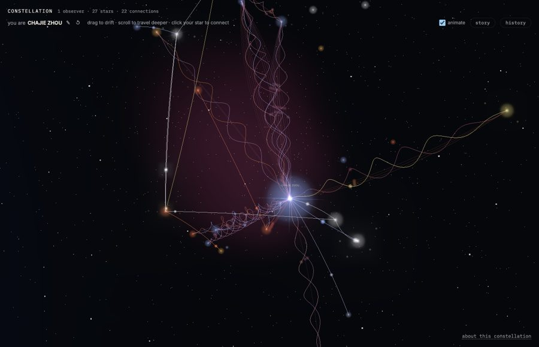
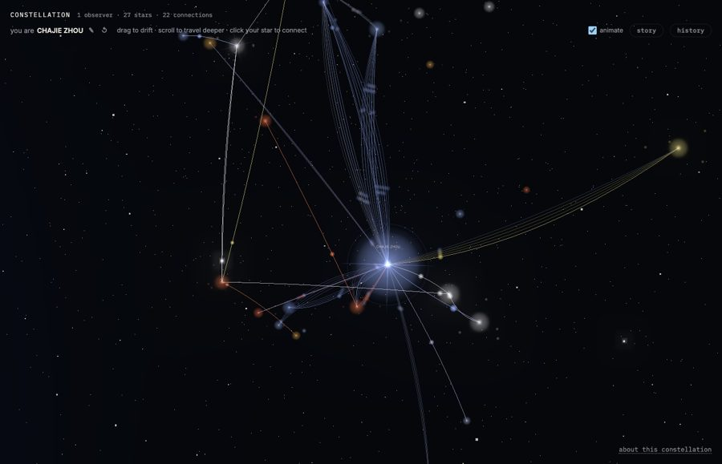

# Making Constellation

## Finding a direction

Before implementation, I talked through the idea with the agent. I knew I
wanted to represent people and relationships, but a basic graph did not feel
personal enough. Eventually I settled on a shared sky that remembers the
people who shaped it. This gave the multi-user, real-time and persistent parts
of the brief a common purpose. It also gave me a reason to exclude chat,
profiles, likes and friend requests.

Shirky and Sloan's writing encouraged me to imagine a particular small group
using the project. Appleton's work helped me think about sensing other people's
presence. Those ideas were useful later, when I was tempted to add more. I
returned to the README to check whether an addition fitted the project I had
set out to make.

One early decision stayed consistent: a connection would contain a history of
declared events, with brightness calculated from that history. This was
established in the first version
([`8ae37b7`](https://github.com/comp4020-agentic-coding-studio/comp4020-final-chajie0824/commit/8ae37b7)).

## Choosing the tools

The server needed to run on one 256 MB machine with one volume. I kept it to
Node `http` and `node:sqlite`, avoiding a framework. For drawing the sky, I
initially used Canvas2D. I switched to Three.js when I wanted depth and light
moving along curved paths
([`3063865`](https://github.com/comp4020-agentic-coding-studio/comp4020-final-chajie0824/commit/3063865)).
An import map loads it from a CDN. That avoids a build step, although it means
relying on the CDN and the user's GPU.

At crit 8, browsers checked for updates every four seconds. Postponing push
updates was an explicit decision in `CLAUDE.md`. For crit 9, I introduced SSE
([`4134be6`](https://github.com/comp4020-agentic-coding-studio/comp4020-final-chajie0824/commit/4134be6)).
The server only needs to send updates to viewers, and `EventSource` reconnects
automatically. ADR 0001 explains why I chose this over WebSockets. I used Web
Audio to generate sound
([`6b24ec5`](https://github.com/comp4020-agentic-coding-studio/comp4020-final-chajie0824/commit/6b24ec5)),
so it needs neither audio files nor a separate build process.

## Working through changes

My usual starting point is using the site myself. I tell Claude Code what
happened or what I found awkward, then it investigates the cause and makes the
change. Changes get separate commits. Pushing requires my instruction because
a push to `main` starts deployment. I keep the reasoning in `CLAUDE.md` and use
ADRs for larger decisions. Including the problem behind a rule matters to me:
without that explanation, it would be easy to read the instruction later and
forget why it was there. The examples from testing and visual changes gave me
specific things to record instead of only describing the result I hoped for.

I use the tests in `spec/` on a temporary server, screenshots from headless
Chrome, and direct use of the app. Over the project, I became more aware of
what each could tell me. Tests could confirm the behaviours I had specified,
but they could miss questions I had never asked. Screenshots helped me judge
appearance, while using the whole scene exposed problems that were harder to
notice in individual images.

## A problem with identity

The audit before crit 10 changed my understanding of the multi-user part. I
asked the agent to check the server against the brief's failure case and found
that the cookie held the star's id. Snapshots expose those ids, so changing the
cookie to another person's id let a user act as that person.

Until then, I had treated two browsers showing different stars as enough
verification. I had not checked whether someone could impersonate another
user. The fix introduced a random session secret whose hash the server checks
([`0264917`](https://github.com/comp4020-agentic-coding-studio/comp4020-final-chajie0824/commit/0264917)).
The permission test now sends a forged old-style cookie and expects rejection.
I considered signing ids, but wanted revocable sessions. Passwords were also
possible, although I wanted people to join by entering just a name.

## Working out what to remove

I learned most from the changes to the sky's appearance. After deciding the
stars looked too plain, I asked for more detail and accepted a series of
suggestions. These included bloom, redshift, mutual connections drawn as a
double helix, nebulae around clusters, a targeting reticle, shockwaves and a
close-up star surface
([`bcf55bf`](https://github.com/comp4020-agentic-coding-studio/comp4020-final-chajie0824/commit/bcf55bf)
to
[`85271b1`](https://github.com/comp4020-agentic-coding-studio/comp4020-final-chajie0824/commit/85271b1)).

I liked the separate screenshots enough to continue. Once everything was
running together, the sky felt crowded. Saying that it looked worse did not
help much because I could not identify which parts caused that feeling.

I asked for the earlier and newer versions to run with the same copy of the
live data. That made the differences easier to follow. The original colours
had stayed the same. What bothered me was the movement of the helix, the pink
old connections and the purple fog around clusters. I removed those three
([`8c83b0b`](https://github.com/comp4020-agentic-coding-studio/comp4020-final-chajie0824/commit/8c83b0b)),
then removed the blue haze and made the stars dimmer
([`74f7237`](https://github.com/comp4020-agentic-coding-studio/comp4020-final-chajie0824/commit/74f7237)).
The brighter version looked cheap to me. Looking at the comparison again helped
me decide that the scene was quiet enough.

Afterwards, I recorded the choices in `CLAUDE.md`: use plain connection arcs,
keep stars restrained, and compare versions before accepting a change to the
overall look
([`14e224f`](https://github.com/comp4020-agentic-coding-studio/comp4020-final-chajie0824/commit/14e224f)).
These instructions now refer to a result I have actually seen. That gives them
more meaning than my earlier general request for a calm sky.

Sound needed a similar revision. Random pings, bright action bells and chord
changes every fourteen seconds made the first version feel restless. I had it
reworked to remove random and percussive sounds, leaving cues for my own actions
([`5fb95ac`](https://github.com/comp4020-agentic-coding-studio/comp4020-final-chajie0824/commit/5fb95ac)).
I listened to the local version before it went live. Both revisions reminded
me that I was responsible for choosing what stayed, even when the agent had
successfully built what I requested.

## Other lessons from debugging

Fixing hover jitter took three attempts; the failed approaches are documented
in `docs/DESIGN-NOTES.md`
([`5ff7e97`](https://github.com/comp4020-agentic-coding-studio/comp4020-final-chajie0824/commit/5ff7e97)).
I also ran tests against the preview database once and filled the sky with test
users. That led to the temporary-database rule
([`561f3a2`](https://github.com/comp4020-agentic-coding-studio/comp4020-final-chajie0824/commit/561f3a2)).
For presence, recent polling used to leave a star glowing for twenty seconds
after its owner left. Presence now follows an open stream
([`4134be6`](https://github.com/comp4020-agentic-coding-studio/comp4020-final-chajie0824/commit/4134be6)),
with the reasoning recorded in ADR 0001
([`8b14b99`](https://github.com/comp4020-agentic-coding-studio/comp4020-final-chajie0824/commit/8b14b99)).
